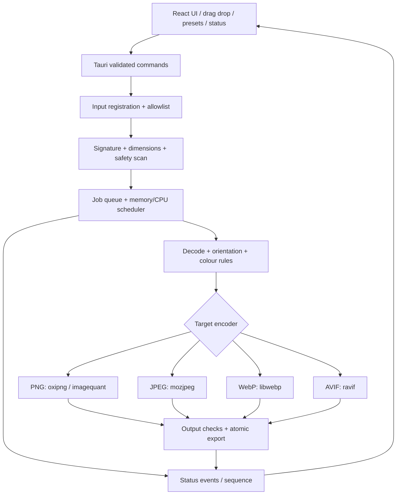

# 03 — Architecture, job model and IPC contract

## Components



## Expected code boundaries

- `pancake-core`: format sniffing, decoder/encoder adapters, validation, memory estimation, quality presets, metadata, safe output, tests.
- `src-tauri`: Tauri setup, OS file dialogs (if needed), path registration and capability handling, job manager, cancellation, event emission and thumbnail requests.
- `src`: React state store, drag area, settings, queue list, comparison preview, progress animation, warnings and export controls.

## Types (conceptual TypeScript schema; implement strongly typed Rust/TS equivalents)

```ts
type Format = 'keep' | 'png' | 'jpeg' | 'webp' | 'avif' | 'auto';
type Preset = 'balanced' | 'small' | 'best-quality' | 'lossless' | 'website';
type State = 'scanning' | 'queued' | 'decoding' | 'encoding' | 'writing' |
 'completed' | 'skipped' | 'failed' | 'cancelled';
type ScanInputRequest = { paths: string[] }; // trusted only after backend registration
// use an opaque backend-issued token in downstream operations, not arbitrary new paths
interface BatchOptions {
  format: Format; preset: Preset; outputToken: string;
  resize?: { width?: number; height?: number; neverUpscale: true };
  preserveMetadata: boolean; // select defaults according to verified codec support
  conflictPolicy: 'rename' | 'skip'; avoidLarger: boolean;
}
interface ProgressEvent {
  schemaVersion: 1; batchId: string; sequence: number; fileId?: string;
  state: State; processed: number; total: number;
  originalBytes?: number; outputBytes?: number; currentName?: string;
  errorCode?: string; message?: string; timestamp: string;
}
```

## Command contract

- `register_inputs({paths})`: validate + register temporary allowlisted paths from user gesture; return opaque input-set token and scan summary. Do not equate a string path from JS with permission.
- `register_output_directory({path})`: canonicalise/validate explicit output selection in Rust; return token. A drag/dropped path alone is not automatically safe.
- `start_batch({inputToken, options}) -> {batchId}`: enqueue without blocking UI; stable IDs; reject invalid options and stale tokens.
- `cancel_batch({batchId})`: sets atomic cancellation; in-flight codec may finish before cancellation applies; no finished exports should be deleted.
- `get_batch_snapshot({batchId})`: ability to reconnect after missed events; monotonically increasing event sequence.
- `request_preview({batchId,fileId,side})`: backend-rendered bounded thumbnail served via narrow internal mechanism; no raw multi-GB byte transfer through IPC.

## Job lifecycle

1. Scan and identify every file; unsupported files get `skipped` reason.
2. Queue only permitted still-image inputs; estimate decoder/encoder memory.
3. Schedule **bounded** parallel tasks by combined predicted peak RAM and CPU; very large files may be refused safely.
4. Decode → orient/transform as policy → encode → validate candidate dimensions/format → compare input/output → safe temp-write/flush/rename.
5. Emit one final terminal status per file and a batch summary. A batch is complete when every file is terminal.
6. Preserve completed outputs on cancellation, remove only incomplete temp outputs.

## Progress guarantees

Overall percent = `terminal_count / total_count * 100` after scan; individual file shows meaningful phase, not a made-up encoding percentage. Queue events can be throttled to 5–10/s, but terminal events must always be sent. Use `sequence` to discard out-of-order events; snapshot is source of truth after re-open/reconnect. Progress reaching 100% means **completed including failures/skips**, while total savings and success counts remain explicit.

## Tauri security boundary

No dynamic remote navigation, no wildcard capability, no generic `shell:allow-execute`, no unrestricted fs plugin. Only needed core IPC and dialogue permissions, with security review of any new plugin. Validate all IPC inputs on Rust side. Webview compromise should not grant arbitrary disk read/write; see threat model.
